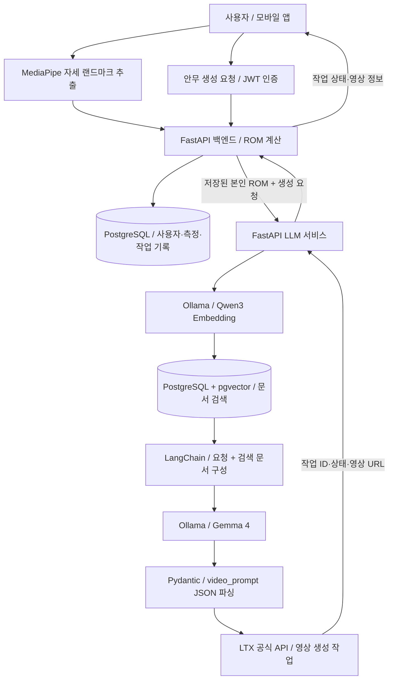

# Tro-Fit — 관절 가동범위와 RAG를 활용한 안무 영상 생성 프로젝트

> 사용자 자세에서 계산한 관절 가동범위(ROM)를 참고하고, 관련 문서를 검색하여 영상 생성 프롬프트를 구성하는 AI 운동 콘텐츠 서비스.

작성 기준: 2026년 10월 10일의 프로젝트 코드와 배포 설정. 이 문서 작성 과정에서는 프로그램 실행, 테스트, 모델 호출을 수행하지 않았다. 개발 기간·참여 인원·개인 기여율은 별도로 기입할 항목이다.

## 1. 프로젝트 소개

Tro-Fit은 카메라 기반 자세 측정과 생성형 AI를 연결하여, 사용자의 움직임 범위를 참고한 안무 영상을 제공하는 프로젝트다. 최종적으로는 사용자가 영상을 보며 따라 할 수 있는 저스트댄스 형태의 경험을 목표로 한다.

일반적인 영상 생성 요청에 사용자의 ROM 측정값과 관절 가동범위 관련 자료를 함께 제공하도록 구성했다. 텍스트 생성, 문서 임베딩, 영상 생성은 각 역할에 맞는 별도 모델이 담당한다.

현재 구현 범위는 **자세 측정·ROM 기록, 문서 검색, 프롬프트 생성, 짧은 영상 생성 작업 접수 및 상태 조회**다. ROM 값으로 통증 부위를 진단하거나, 생성된 안무가 특정 관절의 사용을 제한한다고 보장하는 기능은 구현 범위에 포함되지 않는다.

## 2. 전체 동작 구조



### 2-1. 자세 측정과 ROM 계산

1. 현재 모바일 측정 화면은 Android에서 Expo Camera로 촬영한 이미지를 네이티브 MediaPipe 모듈에 전달해 자세 좌표를 추출한다. WebView 방식의 실험용 컴포넌트도 있으나 기본 설정에서는 비활성화되어 있다.
2. 프론트엔드는 측정 프레임의 랜드마크를 백엔드로 전달한다. ROM 분석 API는 원본 영상을 입력으로 받는 구조가 아니라, 추출된 자세 좌표를 입력으로 받는다.
3. 백엔드는 어깨·팔꿈치·무릎·고관절·발목 등의 기준점으로 3차원 관절 각도를 계산한다.
4. 랜드마크 가시성 정보를 활용해 신뢰할 수 있는 좌표를 판단하고 최대 동작 후보 프레임을 선택한다.
5. 중립 자세와 선택된 최대 동작 자세의 각도 차이를 ROM으로 계산한다.
6. 측정 결과, 관절 정보, 신뢰도 및 사용자별 측정 기록을 PostgreSQL에 저장한다.

각도 계산의 기본 원리는 관절을 중심으로 만든 두 벡터의 내적이다.

```text
u = 기준점 A - 관절 중심 V
v = 기준점 C - 관절 중심 V
관절 각도 θ = arccos((u · v) / (|u| × |v|))
ROM = |최대 동작 자세의 각도 - 중립 자세의 각도|
```

이 결과는 카메라에서 관측한 움직임 범위다. 코드에 있는 가동성 등급과 신뢰도는 시스템의 분석 결과이며, 임상 진단 정확도를 입증한 지표가 아니다.

### 2-2. 문서 임베딩과 벡터 DB 구축

문서 색인은 영상 요청과 분리된 CLI 작업으로 수행한다.

```text
data/의 MD·TXT·텍스트 PDF
    → 텍스트 추출
    → 최대 1,200자 청크 분할 / 200자 중첩
    → Qwen3 Embedding으로 1,024차원 벡터 생성
    → PostgreSQL의 llm_rag_chunks 테이블에 저장
```

벡터와 함께 원문 내용, 파일 경로, PDF 페이지, 임베딩 모델명, 청크 ID를 저장하여 검색 결과의 출처를 추적할 수 있도록 했다. PNG와 텍스트가 없는 스캔 PDF는 현재 OCR 대상이 아니므로 색인에서 제외한다.

`data/`는 RAG에 사용할 원본 자료 모음이다. 파일만으로 RAG가 완성되는 것은 아니며, **문서 분할 → 임베딩 → 벡터 저장 → 검색 → 검색 결과를 포함한 생성** 전체가 RAG 파이프라인을 이룬다.

### 2-3. 검색 자료를 활용한 프롬프트 생성

1. 사용자가 측정 세션을 지정해 안무 생성을 요청한다.
2. 백엔드는 로그인 사용자와 측정 기록의 소유자를 확인한다.
3. 클라이언트가 보낸 ROM 값 대신 DB에 저장된 본인의 측정 결과로 생성 요청을 구성한다.
4. LLM 서비스는 요청을 임베딩하고 pgvector에서 코사인 거리 기반으로 관련 문서를 검색한다.
5. 안무 프롬프트 생성 경로에서는 상위 3개 검색 결과를 Gemma에 제공한다.
6. Gemma는 요청과 참고 자료를 바탕으로 영어 영상 프롬프트를 작성한다.
7. Pydantic 파서가 응답을 `video_prompt` 필드가 있는 JSON으로 변환한다.

LangChain 구성은 다음과 같다.

```text
PgVectorRetriever → 관련 Document 조회
ChatPromptTemplate → ChatOllama → PydanticOutputParser
```

현재 백엔드의 기본 요청은 느린 사이드 스텝, 점프 제외, 정면 고정 카메라, 전신 구도를 지정하고 ROM 결과를 참고 정보로 전달한다. 관절별 수치 제한을 자동 산출하는 별도 규칙 엔진은 아직 없다.

아래 JSON은 출력 형식을 설명하기 위한 예시이며, 이번 문서 작성 중 실제 생성한 응답이 아니다.

```json
{
  "video_prompt": "An adult dancer performs slow side steps without jumping in a bright studio. Static front-facing camera, full body visible."
}
```

### 2-4. 영상 생성과 작업 상태 관리

1. LLM 서비스가 프롬프트를 LTX 공식 API에 전달한다.
2. LTX는 영상 생성 작업을 접수하고 작업 ID를 반환한다.
3. 백엔드는 사용자와 작업 ID를 연결해 저장하고, 프론트엔드에 생성 중 상태를 반환한다.
4. 작업 조회 시 백엔드 → LLM 서비스 → LTX 순서로 상태를 조회한다.
5. 작업이 완료되면 영상 URL을 프론트엔드에 전달한다.

영상 생성 기본 설정은 **6초, 1280×720, 24fps, 무음**이다. 외부 작업 상태는 `pending / processing / completed / failed`로 관리한다.

영상 렌더링은 외부 API의 비동기 작업으로 실행된다. 다만 최초 요청에서는 검색과 Gemma의 프롬프트 생성이 끝나고 LTX 접수가 완료되어야 응답한다. 전체 요청을 별도 큐 워커로 넘기는 구조는 아니다.

## 3. 사용 기술과 선택 이유

| 영역 | 사용 기술 | 프로젝트에서의 역할 |
|---|---|---|
| 프론트엔드 | React Native 0.81, Expo 54, React 19 | 모바일 화면과 웹 빌드 구성 |
| 언어·상태 관리 | TypeScript, Zustand | API 데이터 타입과 클라이언트 상태 관리 |
| 화면 이동 | React Navigation | 측정·결과 등 화면 간 이동 |
| 카메라·자세 추정 | Expo Camera, Kotlin 네이티브 모듈, MediaPipe Pose Landmarker | Android 이미지 기반 자세 좌표 추출; WebView는 별도 실험 경로 |
| 백엔드 | Python, FastAPI, Uvicorn | 인증·ROM 분석·측정 이력·생성 작업 API |
| 입력·출력 모델 | Pydantic | API 스키마와 LLM JSON 출력 파싱 |
| 수치 계산 | NumPy | 관절 각도 및 ROM 계산 |
| 인증 | JWT, PyJWT | 로그인 사용자 식별과 작업 소유권 확인 |
| 관계형 DB | PostgreSQL 16, SQLAlchemy | 사용자·측정·영상 작업 기록 관리 |
| 벡터 검색 | pgvector, psycopg | 문서 임베딩 저장 및 유사도 검색 |
| LLM 구성 | LangChain Core, LangChain Ollama | 프롬프트·모델·파서·Retriever 연결 |
| 모델 실행 | Ollama, NVIDIA GPU | 로컬 텍스트·임베딩 모델 추론 |
| 텍스트 모델 | `gemma4:e4b` | 검색 자료와 측정 결과를 참고한 영상 프롬프트 작성 |
| 임베딩 모델 | `qwen3-embedding:0.6b` | 문서와 검색 질의를 1,024차원 벡터로 변환 |
| 영상 모델 | LTX 공식 API의 `ltx-2-3-fast` | 텍스트 프롬프트에서 영상 생성 |
| 문서 처리 | pypdf | 텍스트 PDF의 페이지별 내용 추출 |
| 서비스 통신 | HTTPX | 백엔드–LLM 및 LLM–LTX HTTP 요청 |
| 컨테이너·웹 서버 | Docker, Docker Compose, Nginx | 서비스별 패키징, 실행 의존성, 웹 배포 및 API 프록시 |

### 모델을 역할별로 분리한 이유

- **Gemma 4:** 안무 장면과 동작을 설명하는 텍스트 생성 담당.
- **Qwen3 Embedding:** 문서 검색에 필요한 의미 벡터 생성 담당. 현재 구성에서는 Gemma를 임베딩에 사용하지 않는다.
- **LTX:** 실제 영상 렌더링 담당. 텍스트 모델의 JSON을 영상 API 요청으로 연결한다.

영상은 로컬의 LTX-Video 2B Distilled가 아니라 **LTX 공식 API의 `ltx-2-3-fast`**를 사용한다. 로컬에서는 텍스트와 임베딩 추론을 수행하고, 영상 생성 연산은 외부 서비스에 맡긴다.

### PostgreSQL과 pgvector를 함께 사용한 이유

기존 백엔드의 PostgreSQL에 pgvector 확장을 추가하여 관계형 데이터와 RAG 벡터를 같은 DB 시스템에서 관리한다. 별도 벡터 DB 서비스를 추가하지 않아 초기 운영 구성을 줄일 수 있다.

현재 검색은 코사인 거리 기반의 정확 검색이며, HNSW·IVFFlat 같은 근사 최근접 이웃 인덱스는 구성하지 않았다. 자료가 늘어나면 검색 지연과 품질을 측정한 후 인덱스 도입을 고려할 수 있다.

## 4. 프로젝트 파일 구조

```text
tro-fit/
├── compose.yaml                   # 전체 서비스 구성
├── deploy/                        # 배포 환경 예시, PostgreSQL 이미지, 안내
├── tro-fit-frontend/frontend/      # Expo / React Native 앱과 웹 빌드
├── tro-fit-backend/
│   └── app/
│       ├── api/v1/endpoints/       # 인증, ROM, 안무 생성 API
│       ├── services/              # ROM 계산 로직
│       ├── models/                # 관계형 DB 모델
│       └── schemas/               # 요청·응답 스키마
├── tro-fit-llm/
│   ├── data/                      # RAG 원본 자료
│   └── app/
│       ├── main.py                # FastAPI 앱과 라우터 연결
│       ├── api/                   # 프롬프트·영상·검색 API
│       ├── core/                  # 환경 설정과 공통 오류
│       ├── schemas/               # 입력과 프롬프트 스키마
│       ├── services/              # 검색·프롬프트·영상 흐름 연결
│       ├── prompts/               # 프롬프트 템플릿
│       ├── chains/                # LangChain 체인과 출력 파싱
│       ├── models/                # 텍스트·임베딩·영상 모델 연결
│       ├── rag/                   # 문서 분할·색인 CLI·Retriever
│       └── db/                    # PostgreSQL 연결·벡터 검색
└── tro-fit-ai-vision/              # 자세 추정·ROM 연구 및 실험 자료
```

`main.py`는 앱 조립에 집중하고, 모델 호출·검색·프롬프트·DB 로직을 역할별 모듈로 분리했다. `tro-fit-ai-vision`은 현재 Docker 배포에서 별도 HTTP 서버로 실행되지 않는다. 서비스의 자세 추출은 프론트엔드, ROM 계산은 백엔드가 담당한다.

## 5. Docker 배포 구조

```text
브라우저
  └─ localhost:8080 → frontend / Nginx
                         └─ /api/ → backend:8000
                                        ├─ postgres:5432
                                        └─ llm:8001
                                              ├─ postgres:5432 / pgvector
                                              ├─ ollama:11434 / GPU
                                              └─ LTX 공식 외부 API
```

Compose로 `frontend`, `backend`, `llm`, `ollama`, `postgres`의 5개 서비스를 구성했다. PostgreSQL 데이터는 외부 볼륨에 보존하고, Ollama는 기존 호스트 모델 파일을 읽기 전용으로 공유하면서 실행 상태는 별도 볼륨에 저장한다.

프론트엔드는 Expo 웹 산출물을 Nginx에서 제공한다. 백엔드·LLM·Ollama는 Docker 내부 네트워크로 연결하며, 웹 API는 Nginx를 통해 접근한다. 환경 설정과 API 키는 이미지에 포함하지 않고 배포 환경 파일로 주입한다.

현재 배포 범위는 **로컬 Docker 환경**이다. 외부 서버·도메인·HTTPS 배포는 별도 작업이며, 현재 웹 빌드에서는 Android 네이티브 자세 추출을 사용할 수 없다. 실제 모바일 자세 측정에는 네이티브 모듈을 포함한 Android 빌드가 필요하다.

## 6. 설계에서 강조할 부분

| 설계 과제 | 적용한 방식 | 설명 가능한 의미 |
|---|---|---|
| 측정 결과와 생성 AI 연결 | DB에 저장된 본인 ROM을 생성 요청에 포함 | 프론트엔드 입력을 그대로 신뢰하지 않고 사용자별 측정 기록 활용 |
| 참고 자료 활용 | 문서 청크·임베딩·pgvector·Retriever 연결 | 요청과 관련된 문서를 검색해 생성 모델에 전달 |
| LLM 출력 형식 관리 | JSON 형식 지정과 Pydantic 파싱 | 다음 단계의 영상 API에 전달할 데이터 구조 명확화 |
| 모델 역할 구분 | 텍스트·임베딩·영상 모델 분리 | 각 작업에 맞는 모델 사용과 독립적인 교체 가능성 확보 |
| 장시간 영상 생성 | 외부 작업 ID 저장 및 상태 조회 | 영상 렌더링 완료를 최초 HTTP 요청에서 기다리지 않도록 구성 |
| 중복 생성 비용 관리 | 사용자별 활성 작업 2개 제한, 제출 자동 재시도 제외 | 과도한 동시 작업과 불명확한 접수 결과의 중복 제출을 줄이는 장치 |
| 배포 단위 정리 | 서비스별 Docker 이미지와 Compose | 프론트·백엔드·AI 서비스를 명시적인 네트워크 경계로 연결 |

위 항목은 현재 코드의 설계를 설명한다. 응답 속도 개선율, 의료적 효과, 검색 정확도처럼 별도 측정이 필요한 성과 수치는 기재하지 않았다.

## 7. 현재 구현 범위와 향후 개선

| 항목 | 현재 상태 | 다음 단계 |
|---|---|---|
| 자세·ROM 분석 | 랜드마크 기반 각도 계산과 측정 기록 저장 코드 구현 | 환경별 측정 품질 평가 및 촬영 안내 개선 |
| RAG | 텍스트 자료 색인과 pgvector 검색 구현 | OCR, 검색 품질 평가, 자료 관리 자동화 |
| 안무 프롬프트 | 기본 동작 요청 + ROM + 검색 자료 활용 | 관절별 허용 범위와 동작 제한을 구조화하는 규칙 추가 |
| 영상 생성 | LTX 작업 접수·상태 조회·URL 반환 구현 | 생성 영상의 자세 재분석 및 제한 조건과의 비교 |
| 피드백 | 사용자 피드백 저장 | 피드백을 다음 생성 조건에 반영 |
| 영상 보관 | 외부 영상 URL 사용 | 만료에 대비한 객체 스토리지 영구 저장 |
| 작업 처리 | HTTP 요청 중 프롬프트 생성, 외부 영상 작업 조회 | 작업 큐, 중단 작업 복구, 중복 요청 방지 키 |
| 저스트댄스 경험 | 안무 영상 생성 흐름 구성 | 음악·박자 동기화, 긴 안무 시퀀스, 실시간 따라 하기 점수 |
| 서비스 배포 | 로컬 Docker 구성 | 운영 서버, HTTPS, 모니터링, 운영 환경 접근 제어 |

통증 진단, 관절 부하 최소화의 수치적 보장, 음악에 맞춘 안무 생성, 실시간 동작 채점은 현재 완료 기능으로 소개하지 않는다. LangChain 변경 이후 전체 통합 동작과 최신 배포 상태에 대한 추가 검증 결과도 이 문서에서 주장하지 않는다.

## 8. 포트폴리오에 사용할 소개문

### 짧은 소개

**Tro-Fit은 카메라로 측정한 관절 가동범위와 RAG 검색 자료를 참고해 안무 영상 프롬프트를 생성하는 AI 운동 콘텐츠 프로젝트입니다. React Native·FastAPI 기반 서비스에 LangChain, Ollama, PostgreSQL·pgvector, LTX 영상 API를 연결하고 Docker Compose로 로컬 배포 환경을 구성했습니다.**

### 상세 소개

Tro-Fit은 사용자의 움직임 범위를 참고한 안무 콘텐츠 제공을 목표로 합니다. 모바일에서 MediaPipe로 추출한 자세 랜드마크를 FastAPI 백엔드로 전달하고, 관절 각도와 ROM을 계산하여 사용자별 측정 기록으로 저장합니다.

안무 생성 시에는 저장된 ROM과 관련 문서를 함께 활용합니다. Qwen3 Embedding으로 문서와 질의를 벡터화하고 PostgreSQL의 pgvector에서 관련 자료를 검색합니다. LangChain으로 연결한 Gemma 4가 이를 참고해 영어 영상 프롬프트를 작성하며, Pydantic으로 파싱한 JSON을 LTX 공식 API에 전달하여 영상 생성 작업을 시작합니다.

텍스트 생성·임베딩·영상 생성의 역할을 분리하고, 생성 작업 ID와 상태를 백엔드에서 사용자별로 관리하도록 구성했습니다. 프론트엔드, 백엔드, LLM API, Ollama, PostgreSQL을 Docker Compose로 연결했습니다. 현재는 짧은 안무 영상 생성 흐름을 구현한 단계이며, 생성 영상의 관절 제한 준수 확인과 박자 동기화·동작 채점은 후속 과제입니다.

## 9. 프론트엔드 상세 — 모바일 사용자 경험과 측정 데이터 전달

### 역할과 사용 기술

React Native·Expo로 로그인, 측정 안내, 카메라 측정, 안무 영상함, 운동 피드백, 리포트 화면을 구성한다. TypeScript로 API와 자세 데이터 타입을 정의하고 React Navigation으로 화면을 이동한다. Zustand는 선택한 운동과 피드백 상태를 관리한다. 공통 버튼·카드·입력창과 색상·간격·타이포그래피를 분리하여 화면 스타일을 재사용한다.

### 측정 화면의 실제 데이터 흐름

```text
카메라 권한 요청
  → 3초 카운트다운
  → 5초 측정 구간 / 최대 3장 사진 수집
  → nativePose.ts의 analyzePoseImage()
  → Android TrofitPoseModule / MediaPipe
  → 좌표·가시성·타임스탬프를 LandmarkFrame으로 변환
  → visionAiJson.ts에서 백엔드 JSON 스키마로 변환
  → POST /api/v1/analyze/rom
```

현재 측정 요청은 어깨 외전(`shoulder / abduction`)을 기본으로 구성한다. 화면의 상태를 `ready → countdown → recording → complete`로 나누고, 카메라 촬영 및 API 제출 상태를 별도로 관리한다.

`nativePose.ts`는 Android 네이티브 모듈의 존재 여부를 확인하고, 네이티브 분석 결과를 프론트엔드 공통 타입으로 변환한다. `visionAiJson.ts`는 관절 좌표, 월드 좌표, 이미지 크기, 프레임 번호 등을 백엔드와 공유하는 JSON 형태로 정리한다.

### 화면별 구현 범위

| 화면·기능 | 관련 파일 | 현재 코드의 범위 |
|---|---|---|
| 로그인·회원가입 | `LoginScreen.tsx`, `SignupScreen.tsx`, `services/api.ts` | 인증 화면 및 로그인·회원가입 API 클라이언트 구성 |
| 측정 안내·카메라 | `MeasurementGuideScreen.tsx`, `MeasurementScreen.tsx` | 권한 요청, 카운트다운, 사진 수집, 자세 분석, ROM API 제출 |
| 분석·생성 안내 | `AnalyzingScreen.tsx`, `GeneratingDanceScreen.tsx` | 안내 UI와 타이머 기반 화면 전환; 실제 생성 작업 완료를 추적하는 화면은 아님 |
| 홈·주차별 영상함 | `HomeScreen.tsx`, `WeeklyDanceLibraryScreen.tsx` | `mockData`의 예시 운동 데이터 기반 표시 |
| 운동 영상 화면 | `ExercisePlayerScreen.tsx` | 도형과 재생 아이콘으로 구성한 UI; 실제 생성 MP4 재생 컴포넌트는 미연결 |
| 난이도 피드백 | `ExerciseFeedbackScreen.tsx`, `exerciseStore.ts` | 피드백 선택 UI와 로컬 상태 관리; 서버 저장 API와 화면의 연동은 별도 과제 |
| 월간 리포트 | `MonthlyReportScreen.tsx` | 예시 점수와 고정 개선율 표시; 실제 측정 이력에서 계산한 통계가 아님 |

`services/api.ts`에는 안무 생성·영상 목록·피드백 제출 함수가 있지만, 해당 함수의 존재만으로 모든 화면이 서버와 연결되었다고 볼 수는 없다. 현재 생성 안내 화면은 약 2.6초 뒤 영상함으로 이동하며, 영상 생성 완료 여부에 따른 전환이 아니다.

또한 측정 화면은 네이티브 분석 결과와 WebView 프레임이 모두 없을 때 **모의 랜드마크로 대체하는 경로**가 있다. API 실패 시에도 분석 안내 화면으로 이동한다. 따라서 포트폴리오 시연에서 실제 측정과 데모 데이터를 구분해야 하며, 후속 구현에서는 모의 데이터의 운영 전송 방지와 오류 상태 표시가 필요하다.

### 프론트엔드 설계 포인트

- 화면, 공통 UI, 스타일, 상태, API 통신, 데이터 변환을 별도 디렉터리로 분리했다.
- 네이티브 자세 추출 결과를 TypeScript 타입으로 변환하여 화면과 플랫폼별 구현 사이의 경계를 만들었다.
- API 주소를 환경변수로 설정하고, 웹 배포에서는 Nginx의 `/api/` 경로로 백엔드에 접근하도록 구성했다.
- Android 네이티브 추론과 실험용 WebView 추론을 구분했다. iOS·웹의 동일한 실측 기능은 현재 완료 범위에 포함하지 않는다.

## 10. 백엔드 상세 — 인증·ROM 분석·생성 작업 관리

### 역할과 계층 구조

FastAPI 백엔드는 사용자 계정, 측정 결과, 영상 생성 작업의 소유권과 저장을 담당한다. ROM 계산은 NumPy 기반 Python 서비스에서 수행하며, LLM 추론과 영상 모델 호출은 별도 LLM API에 위임한다.

```text
HTTP 요청
  → api/v1/routers.py / 엔드포인트 선택
  → schemas/ / 입력 구조 해석
  → 인증 및 사용자 식별
  → services/rom_analysis.py 또는 LLM HTTP 요청
  → models/ + SQLAlchemy Session / PostgreSQL 저장
  → JSON 응답
```

| 계층 | 주요 파일 | 역할 |
|---|---|---|
| 앱 초기화 | `app/main.py` | 앱 생성, 라우터 등록, 상태 확인 경로 |
| API 등록 | `app/api/v1/routers.py` | 인증·ROM·안무 API 등록 |
| 인증 | `endpoints/user.py`, `core/security.py` | 계정 생성, 비밀번호 확인, JWT 발급과 사용자 조회 |
| ROM API | `endpoints/rom.py` | 랜드마크 요청 수신, 분석 호출, 측정 저장과 이력 조회 |
| 분석 로직 | `services/rom_analysis.py` | 관절 각도, 최대 동작 후보 선택, ROM 및 가동성 결과 계산 |
| 안무 연결 | `endpoints/choreography.py` | 본인 측정 조회, LLM 호출, 작업 상태·피드백 저장 |
| 데이터 계층 | `models/`, `crud/`, `db/` | ORM 모델, 사용자 데이터 처리, DB 세션 |

### 주요 API

아래 경로는 `/api/v1`을 기준으로 한다.

| 메서드·경로 | 기능 |
|---|---|
| `POST /signup` | 사용자 계정 생성 |
| `POST /login` | 자격 증명 확인 및 JWT 발급 |
| `POST /logout` | 로그아웃 엔드포인트 |
| `GET /me` | 현재 사용자 조회 |
| `POST /analyze/rom` | 랜드마크 기반 ROM 분석과 결과 저장 |
| `GET /analyze/rom/history` | 로그인 사용자의 측정 이력 조회 |
| `POST /choreography/generate` | 본인 측정 기록을 이용해 영상 생성 작업 접수 |
| `GET /choreography/jobs/{job_id}` | 본인 작업의 생성 상태 조회 |
| `GET /choreography/videos` | 본인 작업 목록과 영상 정보 조회 |
| `POST /choreography/feedback` | 본인 영상 작업에 피드백 저장 |

ROM 분석 API는 비로그인 요청도 받을 수 있지만, 사용자별 이력 조회와 안무 생성은 로그인 사용자와 연결된 기록을 사용한다.

### 인증과 데이터 소유권

비밀번호는 임의 salt와 PBKDF2-HMAC-SHA256으로 해시하고, 로그인 시 저장된 해시와 비교한다. JWT의 사용자 식별값을 이용해 현재 사용자를 조회한다. 안무 생성에서는 요청 세션이 본인 측정인지 확인하고, 작업 조회·피드백 저장에서도 사용자 소유권을 확인한다.

### 주요 저장 데이터

| 데이터 | 저장 내용·관계 |
|---|---|
| 사용자 | 계정 정보, 비밀번호 해시·salt, 프로필 |
| ROM 측정 | 사용자 연결, 세션 ID, 관절·동작·측면, ROM 결과, 가동성 분석, 신뢰도, 측정 시각·주차 |
| 안무 작업 | 사용자 연결, 내부 작업 ID, 요청 세션·주차, 외부 작업 ID, 상태, 영상 URL, 오류 코드, 피드백 |
| RAG 청크 | 원문 출처·페이지·내용, 임베딩 모델, 1,024차원 벡터; LLM 서비스가 관리 |

사용자별 첫 측정 시점을 기준으로 측정 주차를 계산한다. 영상 작업은 내부 UUID와 외부 LTX 작업 ID를 구분하여 저장한다. 사용자별 활성 작업 수를 제한하고, 상태 조회 시 외부 작업 결과를 DB에 반영한다.

### 현재 연결되지 않은 코드

`diagnosis.py`에는 별도 진단 데이터 저장 API 코드가 있으나 현재 `routers.py`의 등록 대상은 아니다. `celery_app.py`와 `choreography_worker.py` 등 이전 작업 파일도 존재하지만, 현재 Compose에는 Celery 워커·Redis 서비스가 없다. 따라서 현재 배포를 Celery 기반 비동기 처리 구조로 설명하지 않는다.

## 11. AI 비전 상세 — 자세 추정과 ROM 알고리즘

### 역할과 사용 기술

`tro-fit-ai-vision`은 영상에서 신체 랜드마크를 추출하고 관절 가동범위를 분석하는 Python 연구·실험 모듈이다. MediaPipe 0.10.35로 자세를 추정하고, OpenCV로 영상 프레임을 읽고 시각화하며, NumPy로 벡터와 각도를 계산한다. 버전은 해당 프로젝트의 `requirements.txt` 기준이다.

이 영역에는 영상 처리 파이프라인, 스냅샷 측정 방식, 관절별 가동성 기준, 결과 시각화 및 벤치마크 스크립트가 포함되어 있다. README의 표현과 관계없이, 이 문서에서는 임상 정확도나 실서비스 품질이 검증되었다고 주장하지 않는다.

### 핵심 모듈

기준 경로: `vision_ai/mediapipe_rom_webcam_pipeline/`

| 모듈 | 구현 역할 |
|---|---|
| `src/core/landmarks.py` | 신체 랜드마크 이름·연결 관계·좌우 구분 정의 |
| `src/core/landmark_extractor.py` | MediaPipe 초기화, 프레임 추론, 일반 좌표와 월드 좌표 추출, 결과 JSON 변환 |
| `src/core/angle_engine.py` | 3점 기반 관절 각도, 가시성 기준, 관절별 분석 결과 생성 |
| `src/core/mobility_score.py` | 기준 파일을 이용한 가동성 등급 및 설명 생성 |
| `src/core/visualizer.py` | 관절 각도 이미지 및 픽토그램 SVG 생성 |
| `src/pipeline/rom_pipeline.py` | 영상 순차 처리, 최대·최소 각도 추적, ROM 집계 및 결과 저장 |
| `src/pipeline/snapshot_rom_pipeline.py` | 중립 자세와 최대 동작 후보 스냅샷 기반 분석 |
| `src/main.py` | 파이프라인 실행 진입점 |
| `rom_grading_criteria.json`, `normal_rom.json` | 관절 가동범위·등급 관련 기준 데이터 |

### 두 가지 분석 방식

**영상 전체 처리 방식:** OpenCV로 프레임을 읽고 MediaPipe VIDEO 모드로 순차 추론한다. `ROMTracker`가 신뢰할 수 있는 관절 각도의 최댓값·최솟값을 누적하고, 차이로 ROM을 계산한다. 프레임별 결과와 통합 결과를 저장하며 FPS·지연 시간 측정 코드가 포함되어 있다. 측정 기능의 존재와 실제 성능 수치는 구분한다.

**스냅샷 방식:** 중립 자세와 최대 동작 후보 등 소수의 정지 프레임을 MediaPipe IMAGE 모드로 독립 분석한다. 전체 영상의 모든 프레임을 처리하지 않고 필요한 자세를 비교하는 설계다. 현재 모바일의 사진 수집과 백엔드의 중립·최대 후보 비교도 이와 유사한 처리 형태를 사용하지만, 동일 패키지를 직접 호출하는 단일 구현은 아니다.

```text
영상 / 스냅샷
  → MediaPipe Pose Landmarker
  → 랜드마크 + world_landmarks + visibility
  → 유효 좌표 선택 / 관절 각도 계산
  → ROM 집계
  → 기준 데이터와 비교한 가동성 결과
  → JSON · 관절 표시 이미지 · SVG
```

### 좌표와 신뢰도 처리

랜드마크의 `x, y, z`와 가시성 정보를 함께 유지하며, 이미지 좌표와 월드 좌표를 구분한다. 각도 엔진은 관절을 구성하는 세 점 중 최소 가시성이 기준에 못 미치면 신뢰 불가로 표시한다. 기본 가시성 임계값 `0.65`는 코드 설정값이며 임상 성능을 입증하는 수치는 아니다.

등급 엔진은 관절별 증가·감소 방향과 기준값을 사용해 `NORMAL / WARNING / CRITICAL` 등의 결과와 설명을 구성한다. 기준 파일과 코드에는 허용 마진도 포함되어 있으므로, 임상 진단 기준 자체를 구현했다고 표현하기보다 **자료 기반 가동성 분류 로직**으로 소개한다.

### 연구 코드와 서비스의 연결 관계

| 실행 위치 | 담당 작업 |
|---|---|
| AI 비전 Python 프로젝트 | 영상·스냅샷 실험, 각도·ROM 알고리즘, 기준 데이터, 시각화 |
| Android 앱 | Expo Camera 사진을 네이티브 MediaPipe 모듈로 분석 |
| FastAPI 백엔드 | 앱이 보낸 랜드마크로 각도·ROM 계산 및 저장 |
| LLM 서비스 | ROM 참고값과 관련 문서를 이용한 프롬프트 생성 |

AI 비전 연구 폴더를 Docker에서 별도 API로 구동하거나, Python 알고리즘 파일 자체를 임베딩해서 호출하는 구조는 아니다. **각도 계산은 코드로 실행하고, RAG는 관련 문서의 텍스트를 검색한다.** 측정 결과는 생성 요청의 입력 데이터로 전달된다.

`vision_ai/benchmark/`에는 MediaPipe와 RTMPose 관련 실험 스크립트가 있다. RTMPose는 현재 앱의 기본 추론 모델이나 배포 서비스로 연결된 것으로 소개하지 않는다.

## 12. 전체 프로젝트 구현 상태를 표현하는 방법

**현재 상태를 가장 정확히 설명하면, Android 자세 측정·백엔드 ROM 분석 코드와 RAG 기반 영상 생성 API를 구성하고, 일부 화면은 예시 데이터로 제작한 통합 진행 단계의 프로젝트다.**

현재 전체 구조도는 서비스 간 API 설계를 나타낸다. 프론트엔드에서 실제 측정 후 생성 버튼을 누르고 완성 영상을 재생하는 모든 단계가 연결·검증되었다는 의미는 아니다. 남은 UI 연동은 측정 응답 보존, 생성 요청, 작업 상태 폴링, 영상 목록 실데이터 표시, 실제 플레이어 연결, 피드백 API 호출이다.

포트폴리오 소개문은 다음처럼 사용할 수 있다.

> Tro-Fit은 사용자 자세 측정과 RAG 기반 안무 영상 생성을 결합하는 프로젝트입니다. React Native·Expo에서 Android 네이티브 MediaPipe 모듈을 연결해 자세 데이터를 추출하고, FastAPI·NumPy로 관절 각도와 ROM을 계산하여 PostgreSQL에 저장합니다. AI 비전 영역에는 영상·스냅샷 분석 파이프라인과 관절 가동성 분류·시각화 코드를 구성했습니다. 생성 AI 영역에서는 Qwen3 Embedding·pgvector로 관련 자료를 검색하고 LangChain·Gemma 4로 영상 프롬프트를 작성한 뒤 LTX API에 생성 작업을 요청합니다. Docker Compose로 서비스 배포 구성을 통합했으며, 현재 일부 프론트엔드 화면은 예시 데이터 기반이고 실제 영상 재생까지의 UI 연동을 확장하는 단계입니다.

## 13. 주요 구현 파일

- [배포 서비스 구성](compose.yaml)
- [배포 안내](deploy/README.md)
- [모바일 자세 추출](tro-fit-frontend/frontend/src/components/measurement/PoseLandmarkerWebView.tsx)
- [ROM 계산](tro-fit-backend/app/services/rom_analysis.py)
- [측정 기록 API](tro-fit-backend/app/api/v1/endpoints/rom.py)
- [인증 기반 안무 생성 연결](tro-fit-backend/app/api/v1/endpoints/choreography.py)
- [LLM 서비스 흐름](tro-fit-llm/app/services/generation_service.py)
- [LangChain 프롬프트 체인](tro-fit-llm/app/chains/video_prompt_chain.py)
- [문서 분할](tro-fit-llm/app/rag/documents.py)
- [pgvector Retriever](tro-fit-llm/app/rag/retriever.py)
- [벡터 저장 스키마](tro-fit-llm/app/db/schema.sql)
- [LTX 영상 API 연결](tro-fit-llm/app/models/video_model.py)

공개 포트폴리오에는 `.env`, API 키, DB 비밀번호, DB 백업 및 사용자 측정 원본을 첨부하지 않는다. 개인 기여 내용을 작성할 때는 위 구현 내용 중 본인이 담당한 범위를 구분해 기재한다.
